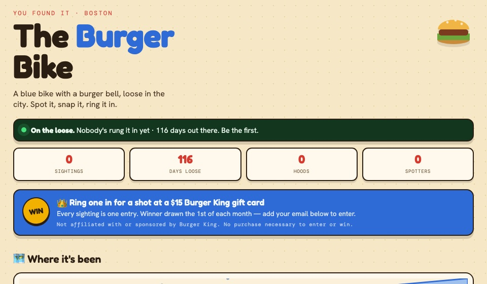

# The Burger Bike 🍔🚲

A blue bike with a burger for a bell, left loose in Boston as a public scavenger hunt. A QR code on the bike opens this site, where whoever finds it uploads a photo and the sighting lands on a live map of the city.

**Live site:** https://burgered-bike.vercel.app



## Features

- **Photo sightings from a phone.** Scan, snap, submit. Photos are resized and compressed in the browser before upload, so they send quickly on cellular data.
- **A hand-built map of Boston.** No map library or tiles: an SVG drawn from real coordinates with one shared projection, showing the Charles, the harbor, the four T lines, colleges, landmarks, and every Bluebikes dock pulled live from the public [GBFS feed](https://gbfs.bluebikes.com/gbfs/en/station_information.json). Sightings are pinned by neighborhood and joined into a trail.
- **Moderation queue.** New sightings are hidden until approved, so nothing a stranger uploads appears on the public board unreviewed.
- **Badges** for repeat spotters (cross the river, spot it after midnight), stored on the visitor's device.
- **Monthly draw.** An optional email enters the spotter into a gift-card draw.

## How it works

```
Phone ──► React app (Vercel) ──► Supabase Storage   (photo)
                             ──► Supabase Postgres  (sighting row, approved = false)

Board ◄── sightings_public view (approved rows only, no email column)
```

There is no backend server. The browser talks to Supabase directly with a publishable key, and the database enforces the rules ([`supabase-setup.sql`](supabase-setup.sql)):

| Rule | How it is enforced |
|---|---|
| Anyone can submit a sighting | Row Level Security `insert` policy for the anonymous role |
| Nobody can read raw submissions | No `select` policy on the `sightings` table |
| The board shows approved sightings only | It reads the `sightings_public` view, filtered to `approved = true` |
| Emails are never exposed | The view leaves the `email` column out |

That is why the Supabase URL and publishable key are committed in [`src/lib/supabase.js`](src/lib/supabase.js): they are designed to ship in client code, and they grant only what the policies above allow.

## Run it locally

Needs Node 18+.

```bash
npm install
npm run dev
```

Open http://localhost:5173. It uses the project's Supabase instance by default.

To use your own: create a free project at [supabase.com](https://supabase.com), run `supabase-setup.sql` in the SQL Editor, then copy `.env.local.example` to `.env.local` and fill in your project URL and publishable key.

## Project layout

| File | Role |
|---|---|
| [`src/BurgerBike.jsx`](src/BurgerBike.jsx) | The whole app: map projection and data, upload flow, badges, styles |
| [`src/lib/supabase.js`](src/lib/supabase.js) | Supabase client |
| [`supabase-setup.sql`](supabase-setup.sql) | Table, policies, public view, storage bucket. Safe to re-run |
| [`.github/workflows/keepalive.yml`](.github/workflows/keepalive.yml) | Daily ping so the free Supabase project isn't paused for inactivity |

## Operating it

- **Approve a sighting:** tick `approved` on its row in the Supabase Table Editor.
- **Monthly draw:** the query is at the bottom of `supabase-setup.sql`.
- **Keep-alive:** GitHub turns off scheduled workflows after 60 days without a commit. If the board stops loading, re-enable the workflow in the Actions tab and restore the project in the Supabase dashboard.
- **QR code:** `npx qrcode "https://burgered-bike.vercel.app" -o bike.png`

## Known limitations

- Sightings are pinned to the neighborhood named in the form, not to GPS coordinates.
- The "guess where it'll be next" poll is a front-end prototype: its starting tallies are placeholders and votes are not saved.
- Badges live in `localStorage`, so they don't follow a spotter across devices.

## Stack

React 18 · Vite · Supabase (Postgres, Storage, Row Level Security) · Vercel · GitHub Actions
